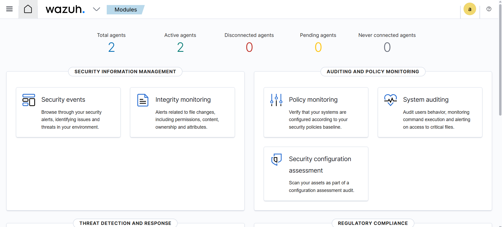
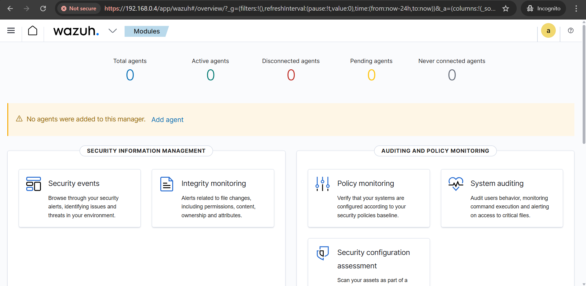

# 8GB SOC Lab — Multi-Endpoint Wazuh SIEM Under Hardware Constraints

A resource-constrained security monitoring lab built with Wazuh, Windows 11, Lubuntu and Ubuntu Server on a host with only 8GB of RAM.

This project documents not only the final deployment, but the engineering decisions, failures and troubleshooting required to make a multi-endpoint SIEM environment usable on limited hardware.

## Project Goal

The goal was to build and operate a practical Wazuh-based SOC lab despite severe workstation constraints.

Rather than treating hardware limitations as a reason not to build the lab, I adapted the architecture and operating model around them.

The final environment included:

- Wazuh Manager on Ubuntu Server
- Windows 11 monitored endpoint
- Lubuntu monitored endpoint
- Centralized agent telemetry in Wazuh
- Headless/server-side administration
- Multi-endpoint agent enrollment and validation
- Resource-aware VirtualBox operation
- Troubleshooting documentation for repeatable recovery

## Lab Architecture

| Component | Operating System | Role |
|---|---|---|
| Wazuh Manager | Ubuntu Server 22.04 | Centralized security monitoring and analysis |
| Windows Endpoint | Windows 11 | Monitored Windows host |
| Linux Endpoint | Lubuntu | Lightweight monitored Linux host |
| Hypervisor | VirtualBox | Local virtualization |
| Host | 8GB RAM workstation | Resource-constrained development platform |

Network mode used during the project: **Bridged Adapter**, allowing the virtual machines to communicate on the same local network.

.png)

## Why the 8GB Constraint Matters

A conventional multi-VM security lab can quickly exceed the memory available on an 8GB workstation.

During the build, resource pressure affected both virtualization stability and security-service availability. Instead of repeatedly retrying the same configuration, I changed the design.

Key decisions included:

- Using Ubuntu Server without a desktop GUI for the Wazuh Manager
- Using Lubuntu as the Linux endpoint rather than a heavier desktop distribution
- Optimizing the Windows VM for reduced resource use
- Running systems strategically rather than assuming every VM could remain active simultaneously
- Using headless operation where appropriate
- Checking services, memory and network state before restarting components
- Treating troubleshooting as part of the engineering process rather than simply reinstalling failed systems

## Architecture and Build Process

The repository contains the build documentation used for the lab:

1. [Wazuh Manager Setup](./setup-guides/1-wazuh-manager.md)
2. [Windows Endpoint Setup](./setup-guides/2-windows-endpoint.md)
3. [Lubuntu Endpoint Setup](./setup-guides/3-lubuntu-endpoint.md)
4. [Agent Enrollment](./setup-guides/4-agent-enrollment.md)
5. [Troubleshooting](./setup-guides/5-troubleshooting.md)

A consolidated command reference is also available:

- [Commands Reference](./resources/commands.md)
- [Useful References](./resources/useful-links.md)

## Endpoint Enrollment and Telemetry

Both Windows and Linux endpoints were enrolled into the Wazuh environment and validated from the manager/dashboard.

The lab provided centralized visibility into endpoint activity and created a platform for examining authentication, operating-system and host-security events.

### Active agents



### Wazuh dashboard



## Troubleshooting Under Resource Constraints

One of the most valuable parts of this project was diagnosing failures created by the host's limited resources.

Problems encountered during the build included:

- VirtualBox instability / Guru Meditation failures
- Wazuh service and installation timeouts
- Resource contention between virtual machines
- SSH host-key conflicts during rebuilds
- Agent connectivity and enrollment problems
- Windows resource overhead

Troubleshooting included:

- Checking host and guest memory consumption
- Inspecting Wazuh service state
- Verifying agent services
- Confirming network addressing and connectivity
- Using headless VM operation
- Reducing unnecessary guest resource consumption
- Running components strategically rather than restarting the entire environment blindly

A core lesson from the project was:

> Diagnose the failing layer first — virtualization, operating system, network, service or agent — before changing the rest of the environment.

## Validation

The completed lab demonstrated:

- Working Wazuh Manager deployment
- Windows agent enrollment
- Linux agent enrollment
- Active endpoint visibility in Wazuh
- Centralized security telemetry
- Stable operation using a resource-aware execution strategy
- Repeatable troubleshooting and recovery steps

Supporting screenshots are stored in [`/screenshots`](./screenshots).

## Skills Demonstrated

### Security Operations

- SIEM deployment and administration
- Endpoint telemetry onboarding
- Security-event visibility
- Log and authentication-event analysis
- Agent health validation
- Security monitoring workflows

### Infrastructure

- Linux administration
- Windows administration
- VirtualBox virtualization
- Networking
- SSH administration
- Service management

### Engineering

- Resource-constrained architecture
- Troubleshooting and root-cause isolation
- System optimization
- Technical documentation
- Repeatable build procedures

## Repository Structure

```text
8GB-SOC-Lab-Wazuh/
├── README.md
├── architecture-diagram (1).png
├── resources/
│   ├── commands.md
│   └── useful-links.md
├── screenshots/
│   └── ...
└── setup-guides/
    ├── 1-wazuh-manager.md
    ├── 2-windows-endpoint.md
    ├── 3-lubuntu-endpoint.md
    ├── 4-agent-enrollment.md
    └── 5-troubleshooting.md
